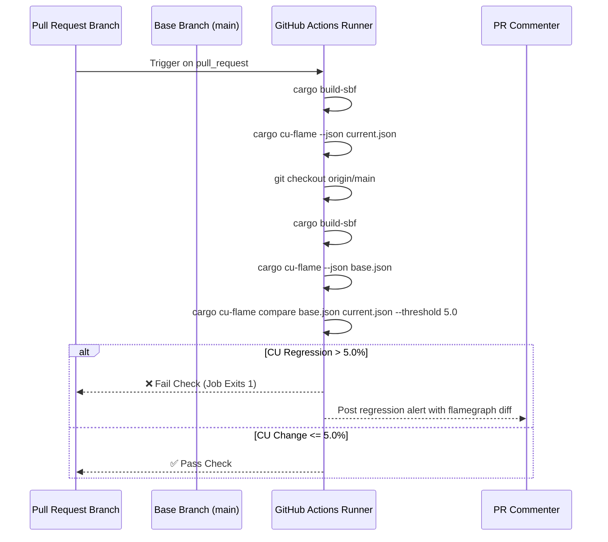

# CI/CD Performance Regression Gating with `sol-flame`

## 1. Why Continuous CU Profiling Matters

In Solana development, introducing an un-cached deserialization or an extra vector allocation can cause an instruction's Compute Unit consumption to jump from 150,000 CU to 205,000 CU.

In production, this causes transactions to fail immediately with:
```text
Program failed to complete: exceeded maximum number of instructions allowed
```

By integrating `sol-flame` into your Continuous Integration (CI) pipeline, pull requests that regress CU performance are caught and rejected **before** they reach staging or mainnet.

---

## 2. The CI Workflow



---

## 3. GitHub Actions Configuration Recipe

Create `.github/workflows/cu-regression.yml`:

```yaml
name: Solana CU Regression Guard

on:
  pull_request:
    branches: [main]

jobs:
  profile:
    name: Compute Unit Gating
    runs-on: ubuntu-latest
    steps:
      - name: Checkout PR Branch
        uses: actions/checkout@v4
        with:
          fetch-depth: 0

      - name: Install Rust Toolchain
        uses: dtolnay/rust-toolchain@stable

      - name: Install Solana sBPF Tools
        run: |
          sh -c "$(curl -sSfL https://release.anza.xyz/stable/install)"
          echo "$HOME/.local/share/solana/install/active_release/bin" >> $GITHUB_PATH

      - name: Install sol-flame
        run: cargo install sol-flame

      - name: Profile PR Branch
        run: |
          cargo build-sbf
          cargo cu-flame --elf target/deploy/my_program.so \
                         --instruction deposit \
                         --output pr-flamegraph.svg \
                         --json current-profile.json

      - name: Profile Base Branch
        run: |
          git checkout origin/main
          cargo build-sbf
          cargo cu-flame --elf target/deploy/my_program.so \
                         --instruction deposit \
                         --json base-profile.json

      - name: Evaluate Regression
        run: |
          cargo cu-flame compare base-profile.json current-profile.json --threshold 5.0

      - name: Upload Flamegraph Artifact
        if: always()
        uses: actions/upload-artifact@v4
        with:
          name: flamegraph-svg
          path: pr-flamegraph.svg
```

---

## 4. Evaluation Engine Mechanics

The `compare` subcommand computes:

$$\Delta\text{CU} = \text{CU}_{\text{current}} - \text{CU}_{\text{base}}$$
$$\text{Percentage Change} = \left(\frac{\Delta\text{CU}}{\text{CU}_{\text{base}}}\right) \times 100\%$$

- If $\text{Percentage Change} \le \text{Threshold}$, exit code is `0` (Success).
- If $\text{Percentage Change} > \text{Threshold}$, exit code is `1` (Failure).
- Improvements ($\Delta\text{CU} < 0$) are highlighted in green terminal output.
