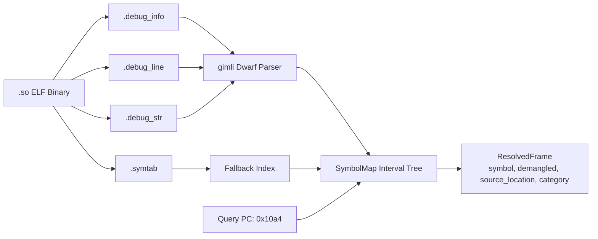

# DWARF Symbolication in `sol-flame`

## 1. The Challenge of Symbolication in Solana sBPF

Solana programs are compiled to an extended Berkeley Packet Filter (sBPF) bytecode target. In release mode, the Rust compiler (`rustc`) aggressively optimizes program binaries:
- Functions are heavily inlined (`opt-level = 3`).
- Dead code is stripped via Link-Time Optimization (LTO).
- Function names are mangled using the v0 or legacy Itanium mangling schemes.

Without debug symbols, an execution profiler only observes raw virtual Program Counter (PC) addresses (e.g. `0x10a4`). Correlating `0x10a4` to the actual Rust line `src/state/vault.rs:42` requires parsing standard DWARF debugging information embedded in the ELF binary.

---

## 2. DWARF Architecture & Section Parsing

`sol-flame-core::symbols::DwarfSymbolResolver` inspects four key ELF sections:



### Parsing Pipeline:
1. **ELF Symbol Table Baseline (`.symtab`):**
   `sol-flame` first scans physical function symbols. If an ELF binary has had its DWARF sections stripped, the `.symtab` provides a resilient fallback mapping.
2. **Subprogram DIEs (`DW_TAG_subprogram`):**
   Traverses the Debugging Information Entries (DIE) tree using `entries.next_dfs()`.
   - `DW_AT_low_pc` & `DW_AT_high_pc`: Extracts contiguous address intervals `[start_pc, end_pc]`.
   - `DW_AT_linkage_name`: Reads the mangled symbol name (e.g. `_ZN11anchor_lang...`).
   - `DW_AT_decl_file` & `DW_AT_decl_line`: Correlates the compilation unit line program header to extract file path and line numbers.

---

## 3. Symbol Demangling & Sanitization

Rust mangles function symbols to ensure symbol uniqueness across crates and generic monomorphizations:

```text
Mangled:   _ZN11anchor_lang18AccountDeserialize15try_deserialize17h5f2b8c9d0e1a2b3cE
Demangled: anchor_lang::AccountDeserialize::try_deserialize
```

`sol-flame` integrates `rustc-demangle` to decode these symbols into human-readable paths and strips trailing compilation hashes (`::h[0-9a-f]+`) for clean visual display.

---

## 4. Semantic Frame Classification

To render intuitive flamegraphs, `sol-flame` automatically categorizes resolved frames into functional domains:

```rust
pub enum FrameCategory {
    Native,          // Business logic and math
    Deserialization, // Borsh / Anchor account deserialization
    Cpi,             // Cross-Program Invocations (spl_token, system_program)
    Syscall,         // Runtime syscalls (sol_log_, sol_invoke_)
    HeapAlloc,       // Bump allocator & memory management
}
```

Classification heuristics evaluate the demangled function path:
- Substrings containing `AccountDeserialize`, `try_from_slice`, or `borsh` $\rightarrow$ `Deserialization`
- Substrings starting with `cpi:` or containing `sol_invoke` $\rightarrow$ `Cpi`
- Substrings containing `sol_alloc_free_` or `bump_allocator` $\rightarrow$ `HeapAlloc`
- All other user functions $\rightarrow$ `Native`
