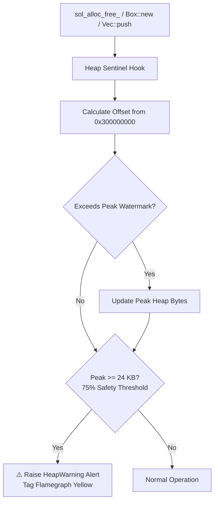

# Solana 32KB Heap Sentinel Guide

## 1. Solana Runtime Memory Architecture

Solana sBPF programs run in a restricted memory space defined by the Solana Virtual Machine:

| Memory Region | Virtual Address Range | Size | Purpose |
| :--- | :--- | :--- | :--- |
| **Stack Memory** | `0x200000000` – `0x200001000` | **4 KB** | Call frames, local variables |
| **Heap Memory** | `0x300000000` – `0x300008000` | **32 KB** | Dynamic allocations (Borsh, Vec, Box) |
| **Input Data** | `0x400000000` – ... | Dynamic | Serialized account info & instruction data |

### The 32KB Heap Limit
Unlike standard Rust binaries that possess gigabytes of virtual memory, a Solana program possesses exactly **32,768 bytes** (32 KB) of bump-allocated heap memory.

When a program attempts to allocate memory past `0x300008000`:
- The bump allocator fails.
- The transaction panics with `Access violation in heap section`.
- All transaction state changes revert, and the transaction fees are lost.

---

## 2. The Heap Sentinel Architecture

`sol-flame-core::heap::HeapMonitor` tracks memory allocations in real-time:

---

## 3. Warning Thresholds

`sol-flame` enforces a conservative 75% threshold:

- **Heap Start:** `0x300000000`
- **Max Heap Size:** `32,768` bytes (32 KB)
- **Warning Threshold:** `24,576` bytes (24 KB, 75%)

### Why 75%?
Memory fragmentation in bump allocators is permanent during an instruction's execution. In Solana's default bump allocator, memory is never freed—calling `free()` is a no-op!

If a program reaches 24 KB during account deserialization, subsequent inner CPIs or serialization routines will frequently crash with out-of-memory errors.

---

## 4. Best Practices to Eliminate Heap Overhead

1. **Adopt Zero-Copy Parsing:** Use libraries like `pinocchio` or `bytemuck` instead of Borsh deserialization. Zero-copy views slice into the read-only input buffer directly (`0x400000000`), using **0 bytes** of heap.
2. **Avoid Dynamic Vectors:** Prefer fixed-size arrays `[u8; 32]` or bounded buffers over `Vec<T>`.
3. **Reuse Allocations:** Avoid re-allocating intermediate strings or formatting buffers inside hot loops.
